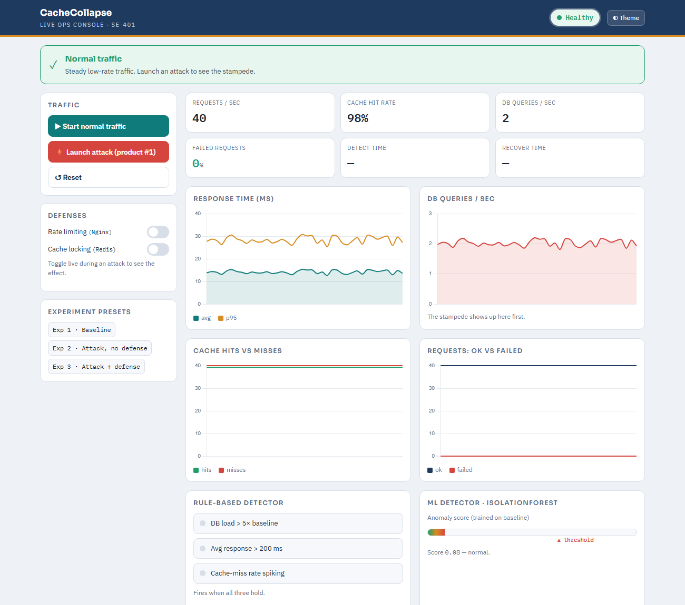
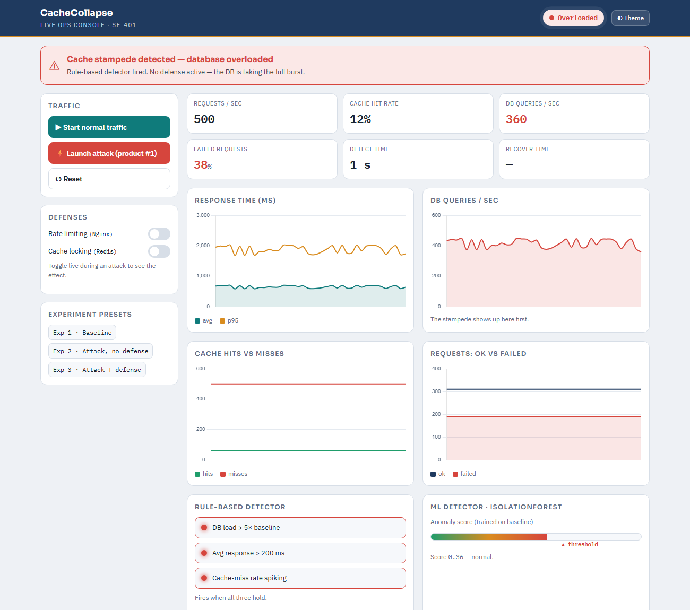
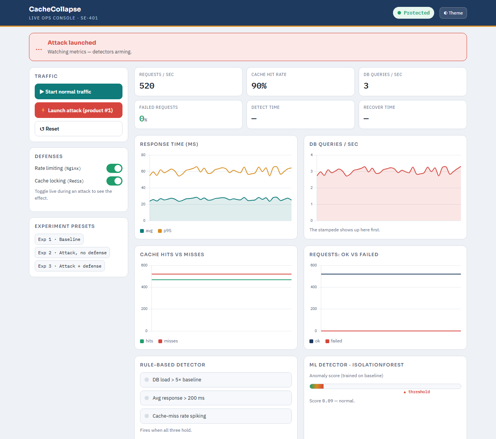

# Design — CacheCollapse

*How the system is built, before any code. Based on docs/spec.md (9-container,
live-monitoring version).*

## 0. Big picture (one line)

Nine Docker containers on one Compose network. A load generator hits an Nginx →
Flask → Redis → PostgreSQL chain. A monitor watches everything, runs rule-based +
ML detection, logs to CSV, and feeds a live custom dashboard. Prometheus + Grafana
give a second, industry-style dashboard.

```
            ┌────────────────────── docker compose network ──────────────────────┐
 Presenter  │                                                                     │
  (browser) │   FRONTEND  ◄── live metrics (SSE/WS) & controls ──►  MONITOR       │
     │      │   dashboard                                           (rules + ML,  │
     ▼      │      ▲                                                 CSV logger,   │
  ┌──────┐  │      │ start/stop, toggle defenses                     live API)     │
  │ UI   │  │      │                                                   ▲   ▲       │
  └──────┘  │   LOADGEN ──► NGINX ──► FLASK ──► REDIS ──(miss)──► POSTGRES         │
            │  (Locust +    (rate     (cache     (TTL +             (victim DB)    │
            │   burst)      limit)    locking)    SETNX lock)         │            │
            │                                                   postgres-exporter  │
            │                            FLASK /metrics ─┐            │            │
            │                                            ▼            ▼            │
            │                                     PROMETHEUS ──► GRAFANA           │
            └─────────────────────────────────────────────────────────────────────┘
```

## 1. Screens

Only one human-facing app: the **custom live dashboard** (the demo showpiece).
Grafana is a second, ready-made dashboard we configure, not build.

**Screen A — Live Dashboard & Control Panel** (single page, always-on live):

- **Top bar:** project title, system status pill (🟢 Healthy / 🟡 Degraded /
  🔴 Overloaded), and a big **DETECTION** banner that turns red when an attack
  is detected (shows which detector fired and the detect time).
- **Control panel (left or top):** buttons —
  - *Start Normal Traffic* / *Stop*
  - *Launch Attack* (burst on product #1)
  - Toggle *Rate Limiting* ON/OFF
  - Toggle *Cache Locking* ON/OFF
  - *Reset* (clear cache, reset counters)
  - A small preset row: *Run Exp 1 / Exp 2 / Exp 3*.
- **Live charts (update every ~1s):**
  1. Response time (ms) — avg & p95
  2. DB queries per second (the stampede shows here)
  3. Cache hit vs miss (stacked)
  4. CPU / memory per container
  5. Requests: success vs failed
- **Detector panel:** rule-based status (the 3 conditions lighting up) and the
  ML anomaly score vs threshold, side by side, so the audience sees both.
- **Key numbers strip:** current RPS, cache hit %, DB qps, failed %, detect time,
  recover time.

**Screen B — Grafana** (separate port, configured dashboards): same metrics, the
"what the industry uses" view. No custom build, just provisioned JSON dashboards.

## 2. User flow (the live demo)

1. Presenter runs `docker compose up`; opens the dashboard (e.g. `localhost:8080`).
2. Clicks **Start Normal Traffic** → charts show low, steady lines (baseline).
3. Clicks **Launch Attack** with defenses OFF → DB qps spikes, response time jumps,
   failed requests climb, status pill goes 🔴, detector banner fires. (Experiment 2.)
4. Presenter clicks **Reset**, turns **Rate Limiting** and **Cache Locking** ON,
   clicks **Launch Attack** again → DB qps stays low (locking coalesces misses),
   failures stay near zero, status stays 🟢. (Experiment 3.)
5. Throughout, every metric is appended to a CSV for the report graphs; Grafana
   shows the same story in parallel.

## 3. Data

- **PostgreSQL** `products` table: `id (PK)`, `name`, `description`, `price`,
  `stock`, `updated_at`. Seeded with ~100 fake products (no real data).
- **Redis** keys: `product:<id>` → JSON string, with TTL (default 10s). Lock key
  `lock:product:<id>` via `SET NX PX` for cache locking.
- **Metrics (in-memory + CSV):** every second the monitor writes a row to
  `monitor/data/metrics_<experiment>_<timestamp>.csv` with columns: `ts, rps,
  db_qps, cache_hits, cache_misses, hit_rate, resp_avg_ms, resp_p95_ms,
  failed, cpu_web, mem_web, cpu_db, mem_db, rule_alert, ml_score, ml_alert`.
- **Run config / toggles:** held in Redis (or a tiny JSON the Flask app reads) so
  the frontend buttons can flip `rate_limit_on` / `cache_lock_on` live.
- No user accounts, no passwords beyond local dev defaults in `.env`.

## 4. Folder plan (PROJECT ROOT = `Cache Collapse/`)

Implementation lives in the **root**, each module in its own folder. Planning
docs stay under `My Ai Agents/docs/`.

```
Cache Collapse/
├── docker-compose.yml          # wires all 9 containers + network + volumes
├── .env                        # local-only ports, DB creds (fake)
├── README.md                   # how to run the demo
├── CacheCollapse-Specification.pdf
│
├── backend/                    # Flask web app (the /products/<id> service)
│   ├── app.py                  # endpoint, cache-check, cache-locking logic
│   ├── cache.py                # Redis get/set + SETNX lock helper
│   ├── db.py                   # PostgreSQL connection + query
│   ├── metrics.py              # /metrics endpoint (Prometheus format) + counters
│   ├── requirements.txt
│   └── Dockerfile
│
├── frontend/                   # custom live dashboard + control panel
│   ├── index.html              # layout (top bar, controls, charts, detectors)
│   ├── css/styles.css          # theme (navy/teal/gold to match the slides)
│   ├── js/app.js               # SSE/WebSocket client, button handlers
│   ├── js/charts.js            # Chart.js live charts
│   ├── server.py               # tiny static server (serves the UI container)
│   └── Dockerfile
│
├── database/                   # PostgreSQL setup
│   ├── init.sql                # create products table
│   ├── seed.sql                # insert ~100 fake products
│   └── Dockerfile              # (or just official image + mounted init scripts)
│
├── nginx/
│   ├── nginx.conf              # reverse proxy + limit_req (rate limiting)
│   └── Dockerfile              # (or official image + mounted conf)
│
├── loadgen/                    # traffic generators
│   ├── locustfile.py           # normal steady traffic
│   ├── attack.py               # precise timed burst (~500 req/s, one product)
│   ├── requirements.txt
│   └── Dockerfile
│
├── monitor/                    # watcher + detectors + live API for the frontend
│   ├── collector.py            # scrape metrics each second
│   ├── detect_rules.py         # IF db-load & latency & miss-spike -> alert
│   ├── detect_ml.py            # IsolationForest (train on baseline, score live)
│   ├── live_api.py             # SSE/WebSocket feed + control endpoints
│   ├── logger_csv.py           # append metrics to CSV
│   ├── data/                   # output CSVs (git-ignored)
│   ├── requirements.txt
│   └── Dockerfile
│
├── monitoring/                 # Prometheus + Grafana config (no code to write)
│   ├── prometheus.yml          # scrape targets (flask /metrics, pg-exporter)
│   └── grafana/
│       ├── dashboards/cachecollapse.json
│       └── provisioning/...    # datasource + dashboard auto-load
│
└── results/                    # saved graphs/CSVs for the final report
```

## 5. Tech choices

| Area | Choice | One-line reason |
|---|---|---|
| Orchestration | Docker Compose | Required by the CEP; runs all 9 modules together, isolated. |
| Reverse proxy | Nginx + `limit_req` | Industry-standard front door; gives us rate limiting for free. |
| Web app | Flask (Python) | Tiny, beginner-friendly; one endpoint is all we need. |
| Cache | Redis | Standard cache; TTL + `SET NX` lock is exactly the stampede/lock story. |
| Database | PostgreSQL | Realistic relational DB to overload and measure. |
| Load — normal | Locust | Beginner-friendly, gives request stats and a UI. |
| Load — attack | Python `asyncio`+`aiohttp` | Precise, timed high-concurrency burst on one product. |
| Detection — rules | Plain Python | Explainable, matches the research question. |
| Detection — ML | scikit-learn `IsolationForest` | Unsupervised, trains on baseline only, no labeling. |
| Metrics store | Prometheus | Standard time-series DB for live scraping. |
| Dashboards (industry) | Grafana | Polished, provisioned dashboards with little effort. |
| Dashboard (custom) | HTML + CSS + Chart.js | No build step; easy to present; live via SSE/WebSocket. |
| Live link UI↔monitor | Server-Sent Events (SSE) | Simplest one-way live push for charts; controls use plain REST. |
| CSV/report graphs | pandas + matplotlib | Turn saved CSVs into report figures. |

## 6. How the two defenses work (design detail)

- **Rate limiting (Nginx):** `limit_req_zone` keyed by client IP, e.g. 50 r/s with
  a small burst; excess returns 503 before reaching Flask/DB. Toggle = swap conf /
  reload (or an app-layer flag for the live button).
- **Cache locking (Flask + Redis):** on a miss, try `SET lock:product:<id> 1 NX PX 3000`.
  - Winner → queries DB once, fills cache, releases lock.
  - Losers → wait briefly and re-read cache (now filled). N misses → 1 DB query.

## 7. How detection works (design detail)

- **Rule-based:** sliding 5s window. Alert when ALL hold: DB qps > baseline×K,
  avg response time > T ms, and cache-miss rate rising fast. Records detect time.
- **ML (IsolationForest):** features = [db_qps, resp_avg, miss_rate, cpu_db, rps].
  Train on Experiment-1 baseline window; at run time, score each second; anomaly
  score beyond threshold = attack. Compare detect time + false alarms vs rules.

---

## 8. UI walkthrough — every element explained

The frontend is a single page, the **Live Ops Console**. Below are screenshots of
the working mockup in its three demo states, followed by a description of what each
control and panel does. (This dashboard is the project's only human screen; the
Flask "web app" behind it is a JSON API with no pages of its own.)

### Screenshot 1 — Baseline (normal traffic, no attack)



Everything is calm: response time ~14 ms, DB queries/sec ~2, cache hit rate ~98%,
status pill **🟢 Healthy**, both detectors dark. This is Experiment 1.

### Screenshot 2 — Attack, no defense (the stampede)



The burst hits an expired cache: DB queries/sec jumps toward ~400, response time
climbs past a second, failed requests rise, the status pill turns **🔴 Overloaded**,
the red banner fires, and both the rule-based and ML detectors light up. This is
Experiment 2 — the problem we are demonstrating.

### Screenshot 3 — Attack + defense (protection holds)



Same attack, but **rate limiting** and **cache locking** are ON: the misses are
coalesced into ~1 DB query, response time stays low, failures stay near zero, and
the status stays **🟢 Protected**. This is Experiment 3 — the fix.

### Element-by-element reference

**Top bar**

| Element | What it does |
|---|---|
| **Title block** (CacheCollapse / Live Ops Console) | Branding; identifies the console. |
| **Status pill** | Live system health: 🟢 Healthy / 🟡 Degraded / 🔴 Overloaded / 🟢 Protected. The pulsing dot means the feed is live. |
| **◐ Theme** button | Switches the whole console between light and dark. |

**Detection banner** (full-width, below the top bar)

| State | Meaning |
|---|---|
| Green "System nominal" | No attack; safe to start. |
| Neutral "Attack launched" | Burst started, detectors arming. |
| Red alert | Attack detected — names which detector(s) fired and whether a defense is holding. |

**Traffic controls** (left rail)

| Button | What it does |
|---|---|
| **▶ Start normal traffic** | Begins steady, light background traffic (the baseline). |
| **⚡ Launch attack (product #1)** | Fires the burst of concurrent requests at one product right after its cache expires — the stampede. |
| **↺ Reset** | Stops traffic, clears the charts and counters, re-arms detection. |

**Defense toggles** (left rail) — can be flipped live, mid-attack, to show the effect

| Toggle | What it does |
|---|---|
| **Rate limiting (Nginx)** | Caps requests per source; sheds excess load before it reaches the database. |
| **Cache locking (Redis)** | On a miss, only one request queries the DB; the rest wait and reuse that result. N misses → 1 query. |

**Experiment presets** (left rail)

| Chip | What it does |
|---|---|
| **Exp 1 · Baseline** | Normal traffic, defenses off. |
| **Exp 2 · Attack, no defense** | Launches the attack with both defenses off. |
| **Exp 3 · Attack + defense** | Launches the attack with both defenses on. |

**Metric tiles** (top strip of the right panel)

| Tile | What it shows |
|---|---|
| **Requests / sec** | Current request rate hitting the system. |
| **Cache hit rate** | % of requests served from Redis (drops hard during an unprotected attack). |
| **DB queries / sec** | Load reaching PostgreSQL — the clearest sign of the stampede (turns red when high). |
| **Failed requests** | % of requests failing/timing out (turns red above 5%). |
| **Detect time** | Seconds from attack start until a detector fired. |
| **Recover time** | Seconds from defense/stop until the system returns to healthy. |

**Live charts** (update every second)

| Chart | What it shows |
|---|---|
| **Response time (ms)** | Average (teal) and p95 (gold) latency. |
| **DB queries / sec** | The database load line — spikes first during an attack. |
| **Cache hits vs misses** | Stacked: green hits vs red misses; misses dominate during an unprotected stampede. |
| **Requests: ok vs failed** | Successful (navy) vs failed (red) requests over time. |

**Detector panel** (bottom of the right panel)

| Panel | What it shows |
|---|---|
| **Rule-based detector** | Three condition lights (DB load > 5× baseline, avg response > 200 ms, cache-miss spiking). All three on → alert. |
| **ML detector (IsolationForest)** | A live anomaly score bar vs a threshold; crossing it flags an anomaly. Lets the report compare rules vs ML. |

---

*The live interactive version of all the above is the published HTML mockup. Once
this design is approved, the same frontend is built for real and wired to the
monitor container's live metrics feed.*
